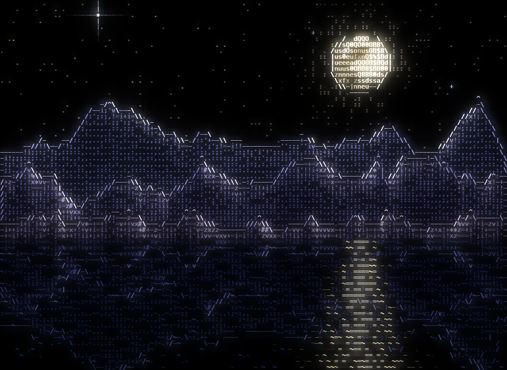
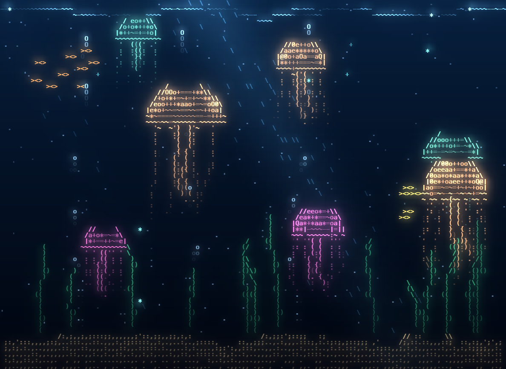

# ASCII Scenes

Animated scenes drawn only in letters, by Clayton Aylor.

```
pip install -r requirements.txt
```

## Moonrise in ASCII




```
python moonrise.py          # a random landscape
python moonrise.py 7        # a specific one
```

Space pause · R restart · N new landscape · S screenshot · Esc quit

## Jellyfish in ASCII




```
python jellyfish.py         # a random sea
python jellyfish.py 7       # a specific one
```

Space pause · R restart · N new sea · S screenshot · Esc quit

## The terminal sketch

`scene.py` is the original sketch: a still night scene printed straight to the terminal, no
dependencies needed.

```
python3 scene.py [seed] [width] [height]
```

## How it works

- **Drawing (shared):** each glyph's coverage mask times its cell's colour, a two-scale glow
  blurred per cell, and trails that let moving letters linger and fade. `jellyfish.py` reuses
  the renderer and window loop from `moonrise.py`.
- **Mountains:** each range's ridge is fractal noise folded at zero for sharp peaks. Edges use the
  stroke that follows the slope (`/ | \ - _ ^`), and slopes that face the moon catch its light.
- **Moon:** a disk measured in pixels so it stays round on tall cells, shaded toward the rim and
  in the craters, filled with letters picked by brightness.
- **Lake:** every row above the horizon is mirrored, shifted sideways by ripples, flipped where it
  matters (`/` to `\`, `^` to `v`) and broken by drifting streaks, with glints under the moon.
- **Jellyfish:** the bell is a dome with a scalloped skirt that squeezes narrow and tall on each
  beat, which pushes it up. Each tentacle point follows where the rim was a moment ago, so the
  strands stream and settle as the bell pulses.
- **Sea:** the light rays are soft bands glowing behind the letters, the sand shimmers with moving
  caustics, and the fish are classic `><>` and `><((('>`.

Python · NumPy · pygame-ce
